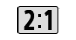
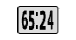
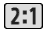
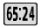

# A7R5 OpenPano

**Unlock panorama frame for Sony A7RM5 camera.**

仓库地址：<https://github.com/OsmoticDuck/a7r5-openpano>

面向 Sony **ILCE-7RM5 / A7R V** 的扩展画幅自定义固件项目。这个 README 里只保留**画幅功能、菜单图标和调试**需要读的内容；构建、哈希、后端实现和给 AI 的提示词都在 [AI_BUILD.md](AI_BUILD.md)。

本仓库不是可直接刷入的固件，也不包含 Sony 固件、私钥、升级器或任何 `BODYDATA.DAT`。

> **风险提示**：自定义固件需要先绕过 Sony 签名校验；刷写错误可能导致相机无法开机，请让 AI 严格按照本仓库或相关基础项目的说明操作。本项目不提供签名密钥、不提供固件，也不对设备损坏负责。

## 使用前必须完成的事项

本仓库**不能单独使用**。请先准备并跑通：

1. **sony-a7r5-custom-firmware**：原厂固件提取、打包、签名和最后功能基线；
2. **a7r5-rea**：DAT 校验工具和相机侧工具。

具体工具链、命令和哈希见 [AI_BUILD.md](AI_BUILD.md)。

这两个项目负责**破解/绕过签名**、提供原厂固件输入、升级器、公私钥和打包环境。本仓库只提供最小功能补丁、图标和说明。

**建议让 AI 按 [AI_BUILD.md](AI_BUILD.md) 操作**；README 不重复构建/哈希细节。

## 增加了什么

### 画幅

- 新增 **2:1**、**2.35:1**、**XPan / 65:24** 三个自定义画幅；
- 也支持设置其他自定义比例；
- 自定义画幅在菜单里作为独立选项出现。

### 取景

- 普通取景按自定义画幅显示，画面**不再被压缩/拉长**；
- 对焦放大（MF）按各自画幅适配，放大区域不再套用 16:9；
- RAW 预览保留完整传感器源，不按 16:9 二次裁切；
- 大图预览按全宽显示，不再只显示中间一条。

### 拍摄

- 自定义画幅可以正常拍摄；
- 照片按拍摄时的画幅记录/裁切，不再被套回 16:9；
- RAW 保留原厂完整源。

### 回放

- 回放按照片实际画幅显示，不按 16:9 二次裁切；
- 普通回放/放大回放的“画面被压扁/拉伸”已修复；
- 进入/退出回放、切换画幅不再重启（实机已确认的基线）；
- **自定义画幅 RAW 的放大查看仍有一个未解决问题，见下。**

### 菜单

- 画幅菜单新增自定义画幅行；
- 菜单增加自定义画幅的图像大小/画幅入口；
- 自制菜单/回放图标见下一节。

### 稳定性

- 切换画幅、进出回放、对焦放大等路径已修复重启问题；
- AF 框修正已包含；自定义画幅下 AF 框/摇杆/合焦颜色正常（按当前实机反馈）。

## 自制画幅图标

菜单和回放各做了 **2:1**、**65:24** 的图标：

| 菜单 2:1 | 菜单 65:24 | 回放 2:1 | 回放 65:24 |
|---|---|---|---|
|  |  |  |  |

- 菜单 76×40、回放 47×32，保留原版圆角底框/透明轮廓；
- 同时提供原生像素格式，便于后续写入固件菜单资源；
- 2.35:1 沿用原厂图标，不在 assets 里重复；
- **当前最小固件仍使用原厂菜单资源占位，这些自制图标尚未写入固件菜单资源**。它们是图标资产，不是可刷固件；真正安装还需要额外的资源记录/ID/容器工作，不属于本最小版本。

图标说明、哈希和原生像素见 [assets/icons/README.md](assets/icons/README.md)。

## 怎么使用

1. **先让 AI 按 [AI_BUILD.md](AI_BUILD.md) 构建/打包**：需要两个基础项目和签名旁路；不要直接把中间文件拼进 DAT。
2. 刷入最终生成的单个 `BODYDATA.DAT`。
3. 在菜单里选择自定义画幅，检查普通取景、对焦放大、拍摄和回放。
4. 切回原厂画幅，确认原厂行为正常。

版本字段只是**容器编号**：填任意比机内当前版本更新的编号即可（例如当前版本 +0.01），没有 Sony 发布语义。最终固件内容固定，DAT 哈希随编号变化；以实际生成并验证的 DAT 为准。

## 调试/恢复

- 如果相机无法启动：先用 SD 卡或 Sony 官方升级程序恢复基础项目/原厂固件，不要连续刷多个自定义包；
- 如果某个画幅在取景/回放/拍摄中异常：记录画幅、菜单路径、是否 MF、是否回放，并把现象交给 AI 对照 [AI_BUILD.md](AI_BUILD.md)；
- 本最小版本不包含 RAW 放大/弹窗探针，也不包含读取/回放/回归工具。

## 目前唯一未解决的问题：自定义画幅 RAW 回放放大

- 用自定义画幅拍摄的 RAW，在回放里按放大时仍会提示**无法放大**；普通取景、回放显示和防拉伸正常；
- 之前的读阶段诊断已经确认：RAW 放大的读取、availability、descriptor 均成功；问题发生在其后的 UI/caution/显示层；
- 最后尝试的 caution 入口诊断包会导致启动循环，已作废，不再使用；
- 这个问题尚未修复，本最小版本不包含相关诊断探针。更细的排查记录在 [AI_BUILD.md](AI_BUILD.md)。

## 已知限制

- 自定义画幅 RAW 回放放大仍会提示“无法放大”（唯一未解决问题）；
- 自定义画幅的菜单文字/图标仍复用全传感器资源；自制 2:1/65:24 图标尚未安装；
- 剩余张数估算可能偏保守；
- 部分菜单/显示资源仍复用原厂实现；
- 具体画幅的实机效果需自行确认。

## 仓库结构

```
README.md
AI_BUILD.md                 给 AI 的构建/打包/后端说明
assets/icons/               自制 2:1 / 65:24 菜单、回放图标
docs/CHANGES.md             功能/后端细节
docs/BASE_PROJECTS.md       两个基础项目的职责和边界
firmware/MANIFEST.json      构建输入/产物的校验哈希
firmware/final/build_minimal.py
LICENSE
NOTICE
```

## 许可与法律

本仓库中由本项目编写的脚本/文档/自制图标按 MIT 许可发布，见 [LICENSE](LICENSE)。Sony、ILCE-7RM5、A7R V 等名称/商标归 Sony 所有；Sony 固件、密钥、升级器和原厂二进制**不在**本仓库中，也不随本仓库分发。使用自定义固件可能违反当地法律/保修条款，风险由使用者承担。