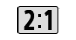
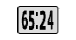
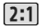
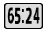

# a7r5-openpano 自制画幅图标

这是项目自制的菜单/回放画幅图标，覆盖：

| 用途 | 画幅 | PNG | 原生 RGBA4444 |
|---|---|---|---|
| 菜单 | 2:1 | `menu-2x1.png` (76×40) | `menu-2x1.rgba4444` |
| 菜单 | 65:24 (XPan) | `menu-65x24.png` (76×40) | `menu-65x24.rgba4444` |
| 回放 | 2:1 | `play-2x1.png` (47×32) | `play-2x1.rgba4444` |
| 回放 | 65:24 (XPan) | `play-65x24.png` (47×32) | `play-65x24.rgba4444` |

 

 

## 说明

- 菜单图标按原版 76×40、回放图标按原版 47×32 制作，保留原版圆角底框/透明轮廓；
- 同时提供 16 像素行对齐的 RGBA4444 原生像素，供后续 UXC 资源安装使用；
- 2.35:1 沿用原厂图标，不在本目录重复提供；
- 图标的数字字形来自原版 UI 字形的逐像素裁片/收窄，不是系统字体替代；
- **这些图标已经安装在 4.92 quality-menu 基线的菜单/回放资源中**；本目录保存的是源文件和备份，不是独立可刷固件；
- 2.35:1 沿用原厂图标；
- 来源与逐图标哈希见 [artwork-manifest.json](artwork-manifest.json)。

## 文件哈希

| 文件 | SHA256 |
|---|---|
| `menu-2x1.png` | `5f7d0cf2e2b381fed8a888c959e8e9a8b891ed34547eef31d98aba15689e9a95` |
| `menu-65x24.png` | `75cc58734bdcb81001d6c0d39a295f185ce4ea2c98108cc7fa8d00b8c7e35221` |
| `play-2x1.png` | `75fd32ca1fff898119aea6e9f876861f62c9d86ef38443ad6f37b9750296dc55` |
| `play-65x24.png` | `85795be450109f301c3be9380f7a41408e2eec5318d277a489bbbc090e8b8f2f` |

Sony 原版图标/原始资源不在本目录；自制图标仅用于本项目。